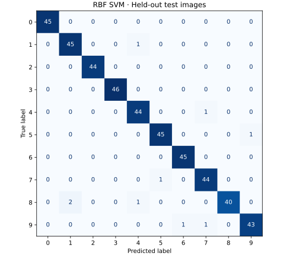

# Digit Recognition Benchmark

Compare logistic regression, a random forest, and an RBF support vector machine on 1,797 handwritten digit images. Each image is an 8 × 8 grid with pixel values from 0 to 16.

## Run locally

Use Python 3.11 or newer.

~~~bash
python -m pip install -r requirements.txt
python digits.py benchmark
python digits.py predict --index 12
python digits.py predict --pixels sample_pixels.txt
~~~

The benchmark saves `artifacts/report.json` with metrics and confusion matrices and `artifacts/confusion_matrix.png` with the selected model's test results. The sample pixel file predicts **0**.

## Results

The stratified split reserves 450 images for final evaluation. The benchmark selects a model using five-fold cross-validation and macro F1 on the 1,347 training images. Scaling runs inside each linear and SVM pipeline, so each fold learns its preprocessing from its own training data.

| Model | Held-out accuracy |
| --- | ---: |
| Logistic regression | 97.78% |
| Random forest | 96.44% |
| RBF SVM | **98.00%** |

The RBF SVM won training cross-validation and correctly classified 441 of the 450 held-out images.

Dataset source [scikit-learn digits dataset](https://scikit-learn.org/stable/modules/generated/sklearn.datasets.load_digits.html).
